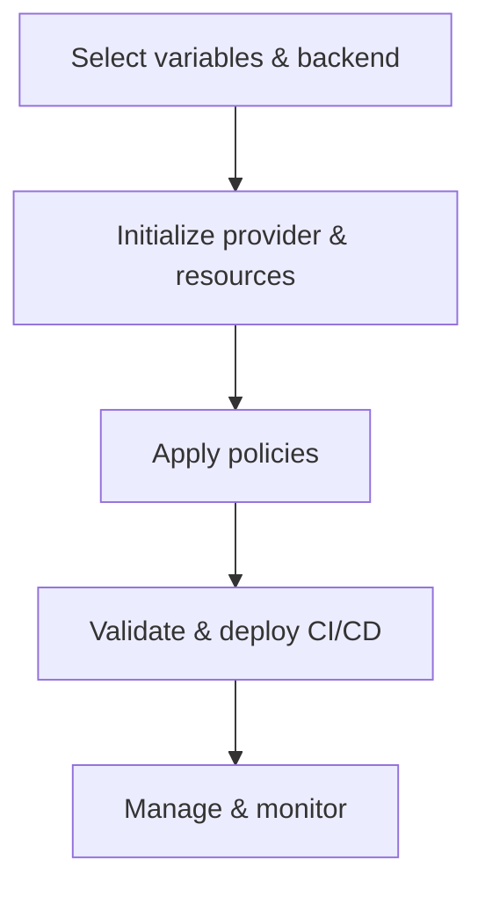

# Vault infra-mgmt Overview & Workflow

## Architecture Overview

The `infra-mgmt` directory manages security, authentication, authorization, and policy management for infrastructure. The structure is modular, making it easy to extend and maintain.

### Main Components

- **Terraform Root Files**  
  Core configuration files: `main.tf`, `provider.tf`, `variables.tf`, `outputs.tf`, `locals.tf`, etc. These define providers, variables, outputs, and overall logic.

- **Modules**  
  - `jwt-auth-internal/`: Manages internal JWT authentication and pipeline policy templates.
  - `policies/`: Manages policies for groups, environments, and services.
  - `transit-key/`: Manages keys for transit encryption.

- **Policies**  
  - Policy files for each group, environment, and service (AWS, DBA, tools, vault-admin, ...).
  - Supports templates and custom policies for each organization and environment.

- **variable.d**  
  - Manages configuration variables for each organization (`lumi`, `starix`) and environment (`dev`, `prod`, `dr`, ...).
  - Each environment has its own `backend.conf` and `variables.tfvars`.

- **CI/CD**  
  - `.gitlab-ci.yml`: Defines automated pipelines for infrastructure validation, deployment, and management.

## General Workflow

1. **Variable & Backend Management**
   - Select appropriate variables by organization and environment from `variable.d`.
   - Configure backend for state storage.

2. **Provider & Resource Initialization**
   - Define providers (AWS, Vault, ...).
   - Initialize resources: IAM, policies, roles, transit keys, groups, users, ...

3. **Policy Application**
   - Apply policies for each group, environment, and service.
   - Use modules and templates for dynamic policy generation.

4. **Validation & Deployment**
   - CI/CD pipeline automatically validates, plans, and applies changes.
   - Manages resource and policy lifecycle.

5. **Management & Monitoring**
   - Audit, backup, token renewal, snapshot, user and permission management.

## Workflow Chart

## Purpose

- Ensure all team members understand the structure, deployment flow, and infrastructure management.
- Easy to extend, maintain, audit, and validate security, authentication, and authorization components.
- Maximize automation via CI/CD, minimize manual errors.

---