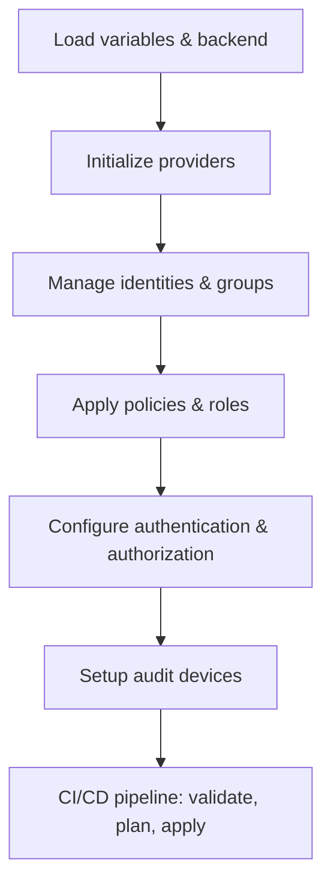

# Vault infra-mgmt Overview & Workflow
## Purpose

- Ensure all team members understand the structure, deployment flow, and infrastructure management.
- Easy to extend, maintain, audit, and validate security, authentication, and authorization components.
- Maximize automation via CI/CD, minimize manual errors.

---
## Architecture Overview

The `infra-mgmt` directory manages security, authentication, authorization, and policy management for infrastructure. The structure is modular, making it easy to extend and maintain.

### Main Components

- **Terraform Root Files**  
  Core configuration files: `main.tf`, `provider.tf`, `variables.tf`, `outputs.tf`, `locals.tf`, etc. These define providers, variables, outputs, and overall logic.

- **Modules**  
  - `jwt-auth-internal/`: Manages internal JWT authentication and pipeline policy templates.
  - `policies/`: Manages policies for groups, environments, and services.
  - `transit-key/`: Manages keys for transit encryption.

- **Policies**  
  - Policy files for each group, environment, and service (AWS, DBA, tools, vault-admin, ...).
  - Supports templates and custom policies for each organization and environment.

- **variable.d**  
  - Manages configuration variables for each organization (`lumi`, `starix`) and environment (`dev`, `prod`, `dr`, ...).
  - Each environment has its own `backend.conf` and `variables.tfvars`.

- **CI/CD**  
  - `.gitlab-ci.yml`: Defines automated pipelines for infrastructure validation, deployment, and management.

## Directory Structure

### Top-Level Files

- **.gitignore**  
  Standard ignore rules for Terraform and sensitive files.

- **.gitlab-ci.yml**  
  CI/CD pipeline automating validation, planning, and deployment of infrastructure changes.

- **main.tf**  
  Entry point for Terraform, orchestrates modules and resources.

- **provider.tf**  
  Declares providers (AWS, Vault, etc.) for resource management.

- **variables.tf**  
  Input variable declarations for the project.

- **locals.tf**  
  Local values for reusable logic and computed values.

- **outputs.tf**  
  Exposes resource attributes for integration and visibility.

- **audit_device.tf**  
  Configures Vault audit devices (file, socket, etc.) for security monitoring.

- **auth.tf**  
  Manages authentication methods (userpass, JWT, Kubernetes, etc.).

- **aws_auth.tf / aws_authz.tf**  
  Handles AWS authentication and authorization integration.

- **groups_global.tf**  
  Defines global groups for cross-environment access.

- **identities_*.tf**  
  Manages user identities, aliases, and group assignments globally and per environment.

- **jwt_gitlab*.tf**  
  Controls JWT-based GitLab pipeline permissions and integration.

- **policies_env.tf / policies_global.tf / roles-policies.tf**  
  Defines and applies policies and roles at environment and global levels.

- **transit-encrypt.tf**  
  Manages Vault transit encryption keys and related resources.

---

### modules/

Modularized logic for reusability and separation of concerns.

- **jwt-auth-internal/**  
  - Implements internal JWT authentication and pipeline policy templating.
  - Contains templates for dynamic policy generation.

- **policies/**  
  - Common logic for group policies, including templates for admin and readonly roles.
  - Subfolders for organization-specific and environment-specific policies.

- **transit-key/**  
  - Manages Vault transit keys for encryption operations.

---

### policies/

Centralized policy definitions for various use cases.

- **aws-authz/**  
  - AWS-specific authorization policies (e.g., DNS challenge).

- **dba/**  
  - Database access policies for different teams and environments.

- **tools/**  
  - Policies for automation, backup, certificate management, monitoring, and admin operations.

- **vault-admin/**  
  - Vault admin policies and self-service password reset.

---

### variable.d/
The `variable.d` directory is the backbone for environment and organization-specific configuration. It enables dynamic selection of variables and backend settings, ensuring each deployment is tailored to its context.

#### Structure

- **lumi/**  
  - **local/**:  
    - `backend.conf`: Backend configuration for state management.  
    - `variables.tfvars`: Variable values for the local environment.

- **starix/**  
  - **dev/**, **dr/**, **klprod/**, **kluat/**, **local/**, **prod/**, **sit/**, **uat/**:  
    - Each contains `backend.conf` and `variables.tfvars` for respective environments.

#### variables.tfvars (Example: starix/prod/variables.tfvars)

- **env, vault_address**:  
  Set the deployment environment and Vault endpoint.

- **application_aws_assume_role**:  
  Specifies the AWS IAM role for Vault integration.

- **bound_gitlab_project_id, bound_gitlab_ref, bound_gitlab_ref_type**:  
  Restricts Vault access to specific GitLab projects, branches, and tags.

- **vault_mount**:  
  Lists Vault mount points and types (e.g., kv-v2 for secrets).

- **polices**:  
  Defines policies to be applied, including name, path, and template.

- **roles**:  
  Role definitions for system/app access (can be empty or populated).

- **kubernetes_auth_role / kube_auth_backends**:  
  Configures Kubernetes authentication roles for Vault.

- **vault_team**:  
  Lists teams for Vault access and management.

- **vault_admin_users / vault_users / vault_users_readonly**:  
  Specifies admin users, all users with team assignments, and readonly users.

- **vault_generic_secret**:  
  Placeholder for generic secrets (can be empty).

- **audit_devices**:  
  Configures audit devices for Vault (file, socket, etc.).

#### backend.conf

- Specifies the backend configuration for Terraform state storage (e.g., remote S3 bucket, workspace).

---

## How It Works

1. **Environment Selection**  
   - Terraform loads variables and backend configuration from `variable.d` based on organization and environment.

2. **Provider Initialization**  
   - Providers (AWS, Vault, etc.) are initialized for resource provisioning.

3. **Identity & Policy Management**  
   - User identities, group assignments, and policies are defined and applied globally and per environment.

4. **Authentication & Authorization**  
   - Multiple authentication methods (userpass, JWT, Kubernetes) are configured.
   - Authorization policies are enforced for AWS, Vault, and other resources.

5. **Audit & Monitoring**  
   - Vault audit devices are set up for logging and monitoring access.

6. **CI/CD Automation**  
   - `.gitlab-ci.yml` automates validation, planning, and deployment, ensuring consistent and secure infrastructure changes.

---

## Workflow Chart

